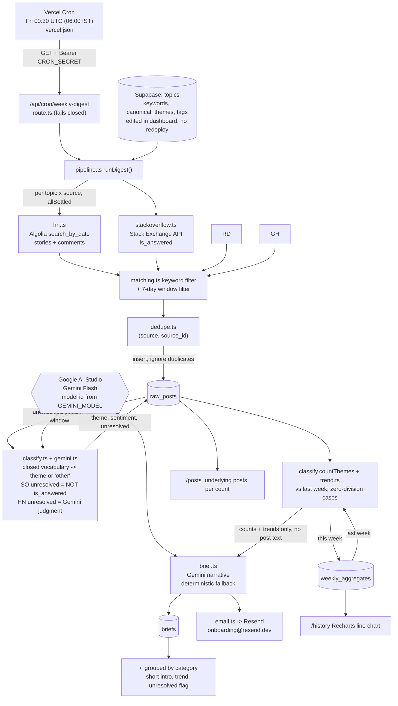

# JARVIS

_Formerly "Dev Pulse". Internal identifiers (repo, package, URLs, env vars, tables, the `dev-pulse-brief-` email idempotency prefix) keep the old name on purpose._

Weekly, AI-generated digest of what developers are complaining about (Hacker News + Stack Overflow),
whether each pain point is trending up or down week over week, and which look unresolved.
Sources: Hacker News, Stack Overflow, Reddit, GitHub Issues. Free tiers only: Vercel, Supabase, Google AI Studio (Gemini Flash), Resend.

**Live:** https://dev-pulse-omega-pink.vercel.app · **Repo:** https://github.com/jigyasabhardwaj01/dev-pulse

## Components Map (as built)

## Design notes

- **Closed vocabulary.** Each topic has `canonical_themes`; anything the model returns outside that list is stored as `other`.
- **Unresolved.** Stack Overflow: `!is_answered` (never asked of the model). HN: Gemini's judgment. A theme is badged
  "unresolved" when at least half its mentions are.
- **Windows.** Rolling 7 whole UTC days ending on the run day (not calendar weeks), so this week and last week are the same length.
- **Idempotent.** Posts are deduped on `(source, source_id)`; aggregates are recomputed from stored classifications each run.
  Posts Gemini failed to classify stay unclassified and are retried on the next run.
- **Degradation.** A dead source, Gemini outage, malformed JSON, a missing post, or a failed email each degrade locally; the brief is always produced.
- **Schema additions** over the original spec: `topics.tags`, `raw_posts.{theme,sentiment,unresolved,classified_at}`,
  `weekly_aggregates.unresolved_count`. RLS is on; only the server's service-role key reads/writes.

## Setup

1. Run `supabase/schema.sql` then `supabase/seed.sql` in the Supabase SQL editor.
2. Copy `.env.example` to `.env.local` and fill it in; set the same variables in Vercel.
3. `npm install && npm test && npm run typecheck`
4. Deploy to Vercel. Cron is configured in `vercel.json`.
5. Seed a trend baseline (optional) by calling the route for the prior week, then for this week:
   `curl -H "Authorization: Bearer $CRON_SECRET" "$URL/api/cron/weekly-digest?asOf=2026-10-02"`

Resend's free `onboarding@resend.dev` sender only delivers to the email on your Resend account, so set `DIGEST_TO_EMAIL` to that address.
